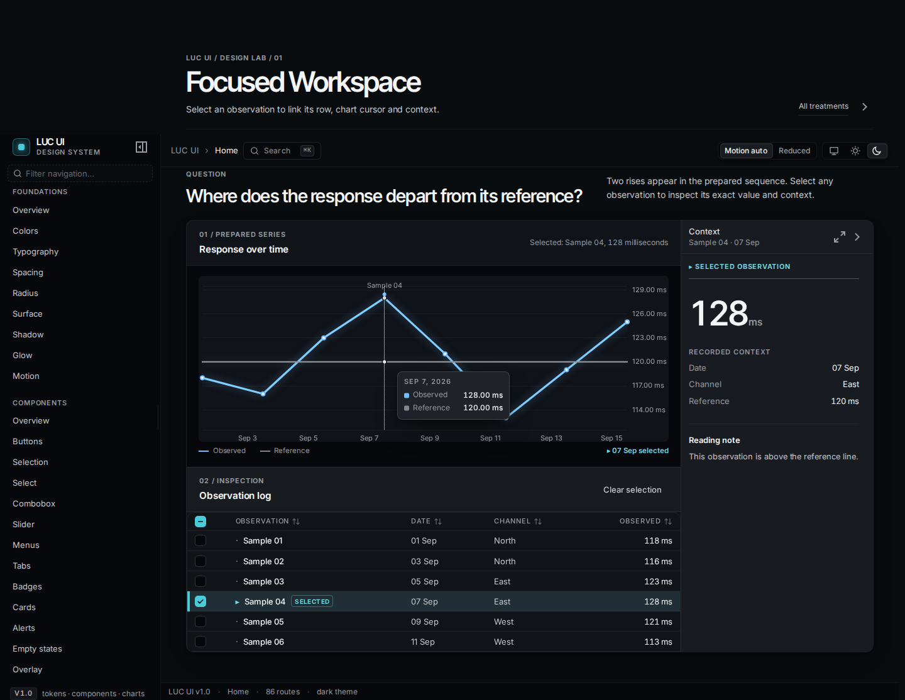
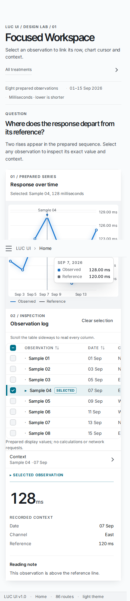

# Design Lab Phase 1

Direct Showcase routes:

- [Treatment index](../../../../apps/showcase/app/experiments/design-lab/page.tsx): `/experiments/design-lab`
- [Precision Instrument](../../../../apps/showcase/app/experiments/design-lab/precision-instrument/page.tsx): `/experiments/design-lab/precision-instrument`
- [Editorial Research](../../../../apps/showcase/app/experiments/design-lab/editorial-research/page.tsx): `/experiments/design-lab/editorial-research`
- [Focused Workspace](../../../../apps/showcase/app/experiments/design-lab/focused-workspace/page.tsx): `/experiments/design-lab/focused-workspace`

All three routes use the same eight prepared observations, public LUC UI components, controlled selection, and chart/inspector behavior. CSS modules change presentation only. No library component, token, export, manifest, consumer, or shared Showcase file was changed.

Status (2026-10-08): finished and verified on the server. Every screenshot in
[`screenshots/`](screenshots/) was re-captured from the production Showcase image
built from this revision (1440×900 and 390×900, dark and light, rest and selected,
plus the reduced-motion states). 24 axe scans reported 0 violations and the linked
selection flow passed on every route. Four files from the earlier interrupted
local run live in [`screenshots/_superseded-local-run/`](screenshots/_superseded-local-run/)
and are not part of the current evidence.

## Evidence and decisions

- [Baseline study](baseline.md)
- [Comparison, test results, and recommendation](comparison-and-results.md)
- [External Skills review and pinned installation plan](skills-install-plan.md)
- [Screenshots](screenshots/)

The reviewed external Skills from the plan are now installed and discoverable; see
[`luc-ui/docs/audits/server-handoff/`](../../../audits/server-handoff/) for the
pinned commits, paths and discovery evidence.

Preview with the existing Showcase dev setup, then open a route directly; these experiments are intentionally absent from shared navigation. For a side-by-side comparison, hold the viewport at 1440×900 or 390×900 and switch only the route and theme. Select “Sample 04” in every route.

